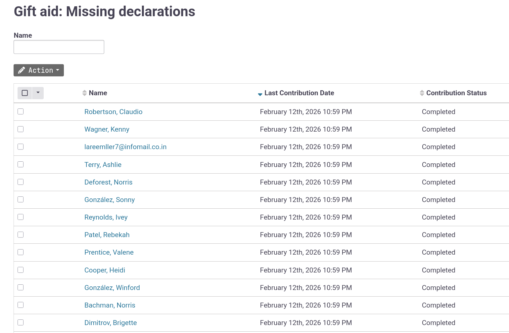
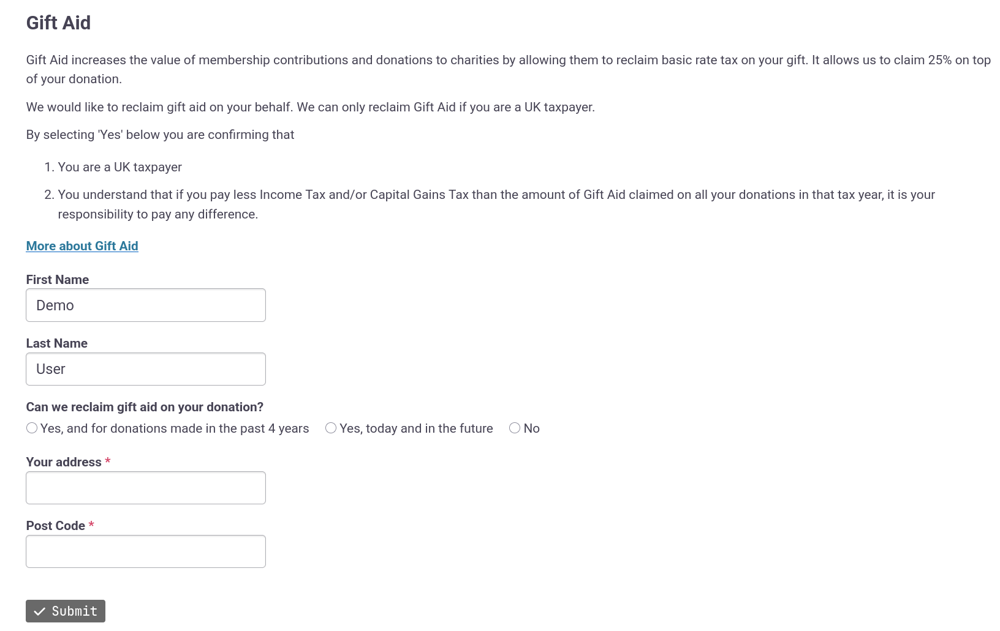

# Collecting Declarations

Sometimes you have donors who have been contributing for a while but who never
signed a Gift Aid declaration. This extension provides two things to help you
chase those declarations up: a search to find the contacts, and a public form
they can fill in.

## Find contacts with a missing declaration

A SearchKit search is provided that lists contacts who have made one or more
contributions in the last 4 years but do not have a Gift Aid declaration on
file.

Go to **Contributions > Gift Aid > Gift aid: Missing declarations** (or
visit `civicrm/gift-aid-missing-declarations` directly).

The search shows the contact name, the date of their most recent contribution
and the contribution status they have. Because it's a SearchKit display you
can use the normal Action menu, for example to email the selected contacts a
link to the declaration form (see below).

## Public Gift Aid Declaration form

A Form Builder (Afform) form is provided so donors can submit a declaration
themselves without needing a CiviCRM login. The form lives at
`civicrm/gift-aid-declaration` and uses the standard Afform page token
permission so it can be sent out via an email link.

The form asks for first name and last name (these are auto-filled when the
contact opens it via a token link), the declaration eligibility, and the
address and postcode. The start date, given date and source fields are filled
in for you - source is set to _Gift Aid Declaration Form_ so you can tell
later which declarations came in this way.

A token is available for this form, so you can
insert a link to it directly from a message template / mailing.

## Putting it together

A typical workflow is to open the _Missing declarations_ search, pick the
contacts you want to write to, and use the _Email_ task to send
them a message template containing a link to the declaration form. When they
fill it in their declaration is created in the normal way - see
[The Gift Aid Declaration](declaration.md) for how new declarations are
handled if the contact already has one.
